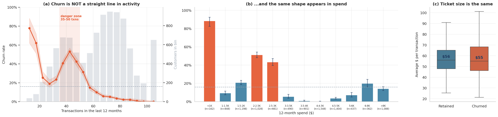
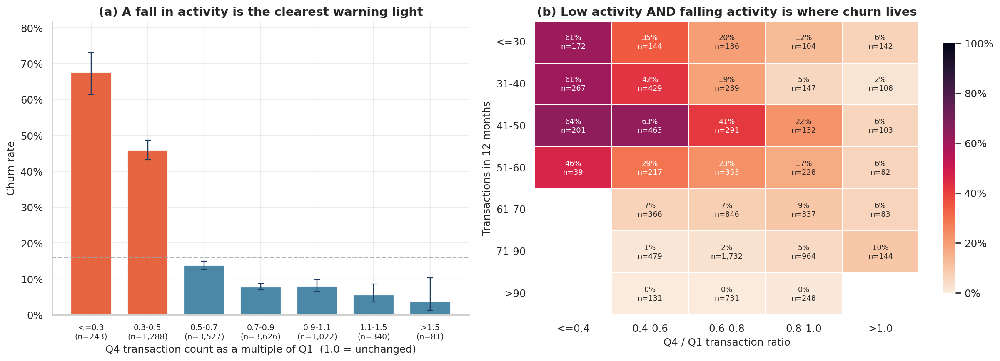
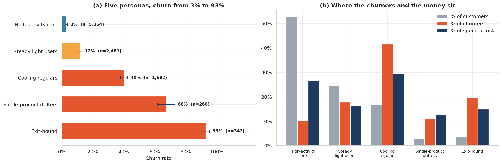
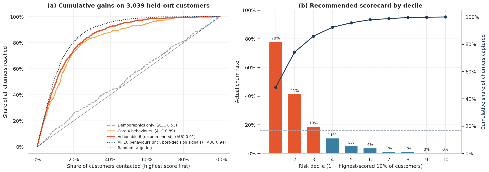
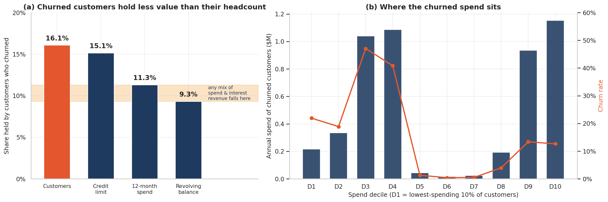

# Why Credit Card Customers Leave - and How to Spot Them Before They Do

**A deep exploratory analysis of 10,127 credit-card customers: behaviour, value at risk, risk personas and a transparent early-warning scorecard.**


> **Start here:** [`notebooks/credit_card_churn_deep_eda.ipynb`](notebooks/credit_card_churn_deep_eda.ipynb) renders on GitHub with all outputs - no setup needed.
> Kaggle version: `<https://www.kaggle.com/code/omjalindarabhale/credit-card-churn-deep-analysis?scriptVersionId=358336338>`

---

## The business question

A bank loses **16.1%** of its credit-card customers (1,627 of 10,127). A retention team needs three answers:

1. **Who** is leaving?
2. **Which signals** appear early enough to act on?
3. **How much value** is at stake, so the budget goes where it pays?

## Key findings

| # | Finding | Evidence |
|---|---|---|
| 1 | **Behaviour predicts churn; demographics do not.** | Age, gender, income, education, marital status, dependents, tenure and card tier score an Information Value of 0.002-0.014, the same as random noise (0.007). A demographics-only scorecard has AUC 0.53; six behavioural signals reach **0.915** on unseen customers. |
| 2 | **Churn is a hump, not a slope.** | 35-50 transactions a year: **45.6% churn, 52.3% of all churners**. Spend of \$2-3K: 48.1% churn; \$3.5-4.5K: 0.4% (9 of 2,449). Ticket size is identical for churners and stayers - they use the card less *often*. |
| 3 | **A falling trend is the clearest warning.** | Q4 activity below half of Q1 (13.5% of customers): **50.9% churn vs 10.6%**, holding 42.8% of churners. |
| 4 | **Thin relationships break first.** | 1-2 products: 26.9% churn vs 11.4% with 4+; the effect holds inside every activity tier. The *Exit-bound* persona churns at **93%**. |
| 5 | **Churn costs less than headcount suggests - except at the top.** | Churners are 16.1% of customers but 11.3% of spend and 9.3% of revolving balances (about 10% of revenue under any mix). The top-20% spenders churn at 13% and hold **41.5% of churned spend**. |
| 6 | **Two "pockets" are post-decision symptoms, not early warnings.** | 73 customers with revolving balances of \$1-\$400 and 54 with six bank contacts churned **100%**. |
| 7 | **Two columns in the file are leaked model output.** | Naive Bayes columns score AUC 1.000 / 0.000 against the real outcome; dropped before any analysis. |
| 8 | **An explainable scorecard turns this into a call list.** | Top 10% of scored customers: 78% churn (4.8x lift), 48% of all churners reached; break-even save rate about 9% under illustrative economics. |

### Churn is not a straight line



### Falling activity is the early-warning light



### Five customer personas: 3% to 93% churn



### An explainable scorecard, validated on unseen customers



### Where the money is at risk



## The eleven questions answered

| Q | Question | Method |
|---|---|---|
| 1 | Who customers *are* or what they *do*: which separates churners? | Information Value ranking with a random-noise benchmark |
| 2 | Is churn simply "less activity, more churn"? | Binned churn curves with Wilson confidence intervals |
| 3 | Does a Q1-to-Q4 activity drop foreshadow churn? | Trend ratio x activity heat map |
| 4 | Do bank contacts and inactivity signal trouble? | Bars with CIs plus a combined heat map |
| 5 | Do more products help, or is it just activity? | Stratified comparison (confounder check) |
| 6 | Women churn more: real or an income artefact? | Like-for-like comparison within income band and activity tier |
| 7 | Do balances and utilisation reveal who has already decided? | Fine balance bands, utilisation x activity |
| 8 | What is churn costing, and who is leaving? | Value-weighted churn, spend deciles, revenue-mix sensitivity grid |
| 9 | Which personas concentrate the churners? | Priority-ordered rules, train/test stability, hidden-segment check |
| 10 | Can an explainable scorecard rank risk? | Weight-of-Evidence scorecard, 70/30 split, AUC / KS / lift |
| 11 | How deep should a retention list go? | Break-even save rate and net-value grid |

## What makes this analysis different

- **Leakage-aware.** The two Naive Bayes columns are *proved* to leak (AUC 1.0) before being dropped, and the scorecard is reported with and without the post-decision signals.
- **Credit-risk toolkit in plain Pandas/NumPy.** Information Value, Weight of Evidence, KS and lift are implemented by hand - no scikit-learn needed.
- **Uncertainty everywhere.** Rates carry 95% Wilson intervals; cells with fewer than 30 customers are blanked; 38 demographic tests are read with multiple-comparison caution.
- **Confounders checked, not assumed.** Products held are re-tested within activity tiers; the gender gap is re-tested within income bands and activity tiers (it reverses at high activity).
- **Value, not just counts.** Revenue is illustrated from stated assumptions and stress-tested across a grid; the high-value "leavers" the activity signals cannot see are surfaced.
- **Honest limits.** A snapshot with no dates, patterns that look unusually clean, and illustrative economics are all stated up front.

## Repository structure

```
credit-card-churn-analysis/
|-- README.md
|-- LICENSE
|-- requirements.txt
|-- .gitignore
|-- notebooks/
|   `-- credit_card_churn_deep_eda.ipynb   # the full analysis, executed, 16 figures
|-- images/                                  # every figure used in the notebook and README
|-- data/
|   `-- README.md                            # how to get BankChurners.csv (data not redistributed)
`-- docs/
    |-- data_dictionary.md                   # raw + engineered columns
    `-- blog_post_draft.md                   # optional write-up for Medium
```

## Run it yourself

```bash
git clone https://github.com/<your-username>/credit-card-churn-analysis.git
cd credit-card-churn-analysis
python -m venv .venv && source .venv/bin/activate      # Windows: .venv\Scripts\activate
pip install -r requirements.txt

# get the data (see data/README.md), then:
jupyter lab notebooks/credit_card_churn_deep_eda.ipynb
```

The notebook looks for `data/BankChurners.csv`, then Kaggle's input folder, then tries to download the dataset with `opendatasets` (needs a Kaggle API key). Tested with pandas 2.3 and 3.0.

## Data

[Credit Card Customers](https://www.kaggle.com/datasets/sakshigoyal7/credit-card-customers) on Kaggle (10,127 rows x 23 columns). The raw file is **not** committed here; see `data/README.md`. Check the dataset's licence on Kaggle before redistributing it.

## Limitations

- The file is a **snapshot**: behaviour and attrition share the same 12 months, so some signals may be consequences of leaving rather than early warnings. All findings are associations.
- The data looks **unusually clean** (a 100%-churn pocket, no women above \$60K), possibly curated or synthetic. Validate on production data before acting.
- There is **no revenue column**: revenue and campaign economics use stated, illustrative assumptions and one year of value.
- Persona thresholds were chosen from exploration; only the scorecard is a clean train/test evaluation. Customers have 13+ months of tenure.

## Tech stack

Python, Pandas, NumPy, Matplotlib, Seaborn, Jupyter.

## About

Built by **Om**, data analyst. Questions or feedback are welcome.
<https://www.linkedin.com/in/om-abhale-2519441a1/> | <https://www.kaggle.com/omjalindarabhale>
